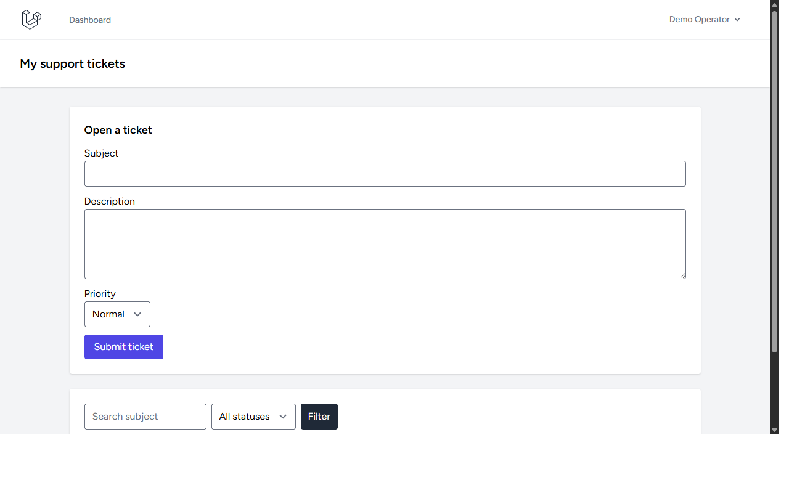

# Support Ticketing Laravel

Authenticated ticket intake and support queue. Requesters create and track only their own tickets; support agents view/manage all tickets, assign agents, update status/priority, reply publicly, or add internal notes hidden from requesters.

## Local setup (Windows)

```powershell
Copy-Item .env.example .env
php C:/Users/wondr/.config/herd-lite/bin/composer.phar install
npm install
php artisan key:generate
php artisan migrate --seed
npm run build
php artisan serve
```

Register normally for requester access. To grant trusted staff access, set `users.is_support_agent = 1` through a controlled administrative process; the public registration form cannot set it. Do not expose staff role assignment to untrusted users.

Statuses: open, in progress, waiting, resolved, closed. Priorities: low, normal, high, urgent. Listing search covers subject; list pagination caps each page at 20. Ticket bodies and comments are output-escaped. Internal comments can only be written by agents and are omitted for requesters.

## Verification

```powershell
php artisan migrate:fresh --seed --no-interaction
php artisan view:clear
php artisan view:cache
php artisan test --compact
npm run build
php C:/Users/wondr/.config/herd-lite/bin/composer.phar validate --no-check-publish
php C:/Users/wondr/.config/herd-lite/bin/composer.phar audit
npm audit --omit=dev
```

No demo tickets/users are seeded. Keep `.env`, personal data, dependencies, SQLite databases, and build output out of Git. SLA automation, email notifications, attachments, and audit history are not implemented.


## Screenshots

### Dashboard Overview


### Login Overview


### Tickets Overview

